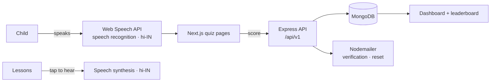

<div align="center">

<a href="https://rayaanq.github.io/Portfolio/#case-lingoleap">
  <picture>
    <source media="(prefers-color-scheme: dark)" srcset="https://raw.githubusercontent.com/RayaanQ/RayaanQ/main/assets/card-lingoleap-dark.svg">
    
  </picture>
</a>

# LingoLeap — Gamified Speech Therapy in Hindi

**A web app that helps children in Hindi-speaking communities who have misarticulation practise pronunciation between therapy sessions, using speech recognition, audio lessons and game mechanics.**


[Case study](https://rayaanq.github.io/Portfolio/#case-lingoleap) · [Pitch deck](https://www.canva.com/design/DAF46kiPCxw/AnhzPyR1pIgxE3TdFUDAeg/view?utm_content=DAF46kiPCxw&utm_campaign=designshare&utm_medium=link&utm_source=editor) · [Setup](#-getting-started)

</div>

---

## ✦ Why

Speech-therapy material is scarce in Hindi, and drills are boring for kids, so practice drops off between sessions. LingoLeap makes that practice something children *want* to come back to: they hear a sound, say it out loud, get instant feedback, and earn their place on a leaderboard.

## ✦ Features

- 🔤 **Learn:** lessons for Hindi **letters** (vowels and consonants), **words** and **sentences**. Tap any item to hear it pronounced in Hindi (`hi-IN` speech synthesis).
- 🎙️ **Speak quiz:** the child says the answer out loud, and in-browser speech recognition (`hi-IN`) checks the pronunciation and scores it.
- 👂 **Listen quiz:** hear a sound and pick the right answer.
- 🏆 **Motivation:** quiz scores, a personal dashboard and a leaderboard.
- 👤 **Accounts:** sign up, log in, email verification, password reset, and profile settings (username, email, password, profile picture).
- 🔐 **Secure by default:** bcrypt-hashed passwords, JWT sessions in HTTP-only cookies, and route protection with Next.js middleware.

## ✦ How it works



## ✦ Getting started

You need Node.js 18+ and a MongoDB database (local or Atlas). Speech recognition works in Chromium browsers such as Chrome and Edge.

**1. Next.js app** (http://localhost:3000). Create `.env` in the project root:

```env
MONGO_URI=your_mongodb_uri
TOKEN_SECRET=your_secret
DOMAIN=http://localhost:3000
```

```bash
npm install
npm run dev
```

**2. Express API** (http://localhost:5000). Create `Backend/.env`:

```env
MONGO_URI=your_mongodb_uri
JWT_SECRET=your_secret
JWT_LIFETIME=1d
DOMAIN=http://localhost:5000
```

```bash
cd Backend
npm install
npm start
```

## ✦ API

| Method | Endpoint | Description |
|---|---|---|
| `POST` | `/api/v1/auth/register` | Create an account |
| `POST` | `/api/v1/auth/login` | Log in |
| `DELETE` | `/api/v1/auth/logout` | Log out |
| `POST` | `/api/v1/auth/verify-email` | Verify email |
| `POST` | `/api/v1/auth/forgot-password` | Send a reset link |
| `POST` | `/api/v1/auth/reset-password` | Reset the password |
| `GET` | `/api/v1/user/showMe` | Current user |
| `PATCH` | `/api/v1/user/updateUser` | Update the profile |
| `PATCH` | `/api/v1/user/updateUserPassword` | Change the password |
| `GET` | `/api/v1/user/leaderboard` | Leaderboard |

## ✦ Project structure

```
├── src/
│   ├── app/
│   │   ├── components/        # Hero, Navbar, letter/word/sentence charts and lessons
│   │   ├── data/              # Hindi letters, words, sentences, quiz banks
│   │   ├── user/              # dashboard, quizzes (listen / speak), leaderboard, settings
│   │   ├── api/users/         # Next.js auth routes (signup, login, verify, me, logout)
│   │   └── login · signup · profile · verifyemail
│   ├── models/ · dbConfig/ · helpers/
│   └── middleware.ts          # protects user routes
└── Backend/                   # Express API: auth, users, email, JWT, error handling
```

---

<div align="center"><sub>Built by <a href="https://github.com/RayaanQ">Rayaan Quraishi</a> · <a href="https://rayaanq.github.io/Portfolio/">Portfolio</a> · <a href="https://www.linkedin.com/in/rayaan-quraishi">LinkedIn</a></sub></div>
